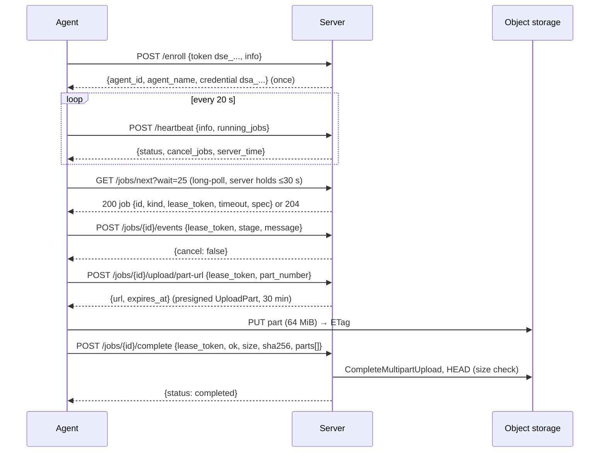

# Architecture

This document describes how DumpStation v2 is put together and how a backup
or restore moves through it. Source references point at `server/internal/...`.

- [Components](#components)
- [Control plane and execution plane](#control-plane-and-execution-plane)
- [Backup job lifecycle](#backup-job-lifecycle)
- [Agent protocol](#agent-protocol)
- [Data transfer and integrity](#data-transfer-and-integrity)
- [Restore paths](#restore-paths)
- [Scheduling](#scheduling)
- [Retention](#retention)
- [Failure handling](#failure-handling)

## Components

| Component | Where | Role |
| --- | --- | --- |
| Server | `cmd/server`, image `ghcr.io/monzim/dumpstation` | REST API (`/api/v1`), agent API (`/agent/v1`), web UI (static files from `WEB_DIR`), scheduler, job orchestrator, direct executor, retention, notifications |
| Metadata database | PostgreSQL | Users, databases, storage, notification channels, backups, restores, agents, agent jobs, job events, activity log. Schema is migrated automatically on start (`internal/database`) |
| Agent | `cmd/agent`, image `ghcr.io/monzim/dumpstation-agent` | Outbound-only worker. Runs `pg_dump`/`pg_restore` next to private databases |
| Object storage | S3, R2, MinIO, S3-compatible | Holds backup artifacts under `backups/<database-id>/<name>_<timestamp>_<backup-id>.dump` |
| `pgexec` | `internal/pgexec` | Shared by server and agent: tool discovery, connection validation, dump, restore, error classification |
| Web UI | `web/` (React, TanStack Router/Query, Astryx) | Built into the server image and served from the same origin |

Server packages that matter for jobs:

| Package | Responsibility |
| --- | --- |
| `jobs` | Orchestrator: enqueue, direct execution, agent queue, finalize/fail, cancel, retention, lease expiry, queue expiry, connectivity tracking, missed-schedule detection |
| `agentapi` | HTTP handlers for `/agent/v1/*`, agent authentication, rate limits |
| `agentproto` | Wire types shared by server and agent |
| `scheduler` | Cron entries per database (robfig/cron, `CRON_TZ` per schedule) |
| `storage` | S3 client: streaming upload, multipart presigning, head, delete, presigned download |
| `secret` | Transparent at-rest encryption of secret columns (`enc:v1:` prefix) |

## Control plane and execution plane

```
            ┌──────────────────────── control plane (server) ───────────────────────┐
 UI/API ──▶ │ handlers ──▶ jobs.Orchestrator ──┬──▶ direct executor (pgexec, in-process)│
 scheduler ▶│                                  └──▶ agent_jobs table (durable queue)    │
            │ agentapi ◀──── long-poll / events / complete ──── agents                 │
            └───────────────────────────────────────────────────────────────────────────┘
```

- **Control plane** (always the server): validates requests, decides the
  executor from the database's `execution_mode`, assigns storage keys,
  issues presigned URLs, verifies artifacts, records history, applies
  retention, sends notifications and writes the activity log.
- **Execution plane**: either the server's own direct executor or an agent.
  Executors run only three job kinds: `backup`, `restore`, `test_connection`.
  They never choose storage keys, never hold storage credentials (agents) and
  never receive arbitrary commands.

Both executors converge on the same `FinalizeBackup` / `failBackup` code, so
history, retention, notifications and activity entries are identical for
direct and agent backups.

## Backup job lifecycle

A backup row has a **status** and, while active, a **stage**:

```mermaid
stateDiagram-v2
    [*] --> pending: enqueue (manual or scheduled)
    state pending {
        queued
        waiting_for_agent
    }
    pending --> running: executor starts (direct slot free / agent leases job)
    state running {
        preparing --> dumping --> uploading --> verifying
    }
    running --> pending: agent lease expired, retry scheduled
    pending --> cancelled: cancel while queued
    running --> cancelled: cancel acknowledged
    pending --> failed: queue TTL expired / agent unavailable
    running --> failed: classified error
    running --> success: object verified in storage
    success --> deleted: retention
```

| Stage | Meaning |
| --- | --- |
| `queued` | Waiting for a direct worker slot (`BACKUP_CONCURRENCY`) or for an online agent to lease it |
| `waiting_for_agent` | The assigned agent is offline; the job waits until it reconnects or the queue TTL expires |
| `preparing` | Connecting, reading `server_version`, choosing `pg_dump` |
| `dumping` | `pg_dump --format=custom -Z 6` writing to a temp file while hashing |
| `uploading` | Direct-to-storage or proxied upload |
| `verifying` | Server checks the object exists and has the dumped size |

Rules:

- Only one active (pending or running) backup per database. A scheduled run
  that fires while one is active is skipped; a manual trigger returns `409`
  with the active backup.
- The executor and agent are recorded on the backup (`executor`, `agent_id`),
  and the backup is pinned to the storage configuration that was current when
  it was queued (`storage_id`).
- Every step writes a **job event** (`job_events`: level, stage, source
  `server` or `agent`, message). The UI shows this as the execution log.
- Failures carry an `error_code` (see [TROUBLESHOOTING.md](TROUBLESHOOTING.md))
  and a sanitized message plus tool-output tail.

## Agent protocol

All requests are made by the agent to `https://<server>/agent/v1/...`. The
server never connects to the agent. JSON bodies are limited to 1 MiB; artifact
transfers are streamed.



### Enrollment and credentials

1. An operator creates an agent in the UI (`POST /api/v1/agents`). The agent
   row starts as `pending` and a single-use **enrollment token** (`dse_` +
   64 hex chars) is returned once. Its TTL is 10 minutes to 24 hours
   (default 60 minutes). Issuing a new token invalidates earlier unused ones.
2. The agent calls `POST /agent/v1/enroll` with the token and its info
   (version, hostname, platform, installed `pg_dump` majors, connection names,
   transfer modes, restore flag, concurrency).
3. In one transaction the server checks the token (unused, unexpired, agent
   not revoked), marks it used, stores the SHA-256 of a new **credential**
   (`dsa_` + 64 hex chars), sets the agent `active` if it was `pending`, and
   returns the credential once.
4. The agent saves `{server_url, agent_id, credential, sha256(token)}` to
   `$DUMPSTATION_STATE_DIR/credentials.json` (mode 0600). On restart it reuses
   that credential unless the server URL or the enrollment token changed, in
   which case it enrolls again (this is how credentials are rotated).

Every other call sends `Authorization: Bearer dsa_...`. The server looks up
the agent by credential hash; unknown or revoked agents get `401`, which makes
the agent stop with a "re-enroll" message. Agent status values:

| Status | Heartbeats | New work |
| --- | --- | --- |
| `pending` | n/a (not enrolled) | no |
| `active` | yes | yes |
| `disabled` | yes | no (new backups for its databases fail with `agent_unavailable`) |
| `revoked` | rejected (`401`) | no; credential hash is cleared |

Connectivity (online / offline / never connected) is derived from
`last_seen_at`: an agent is online if it made any authenticated request in the
last 90 seconds.

### Heartbeat

Every 20 seconds the agent posts its info and the IDs of jobs it is running.
The server updates metadata (shown on the agent page), extends the leases of
those jobs, and answers with `cancel_jobs`: running jobs that were cancelled,
finished, reassigned or are no longer leased to this agent.

### Long-poll and leasing

`GET /agent/v1/jobs/next?wait=N` (N capped at 30) re-checks the agent's status
on every iteration, then tries to claim a job:

- Only jobs for this agent, with `status = queued`, `available_at <= now` and
  `expires_at > now`, oldest first, claimed with `SELECT ... FOR UPDATE SKIP
  LOCKED`.
- `restore` jobs are only offered if restores are allowed on both the server
  and the agent.
- The agent's reported `max_concurrency` caps how many jobs it holds at once.
- Claiming sets `status = leased`, a random **lease token**, `lease_expires_at
  = now + AGENT_JOB_LEASE_SECONDS` (default 120 s) and increments `attempts`.

When a job is queued the server wakes the agent's pending long-poll
immediately; otherwise it re-checks every 5 seconds until the wait ends and
returns `204`.

### Leases

Every job-scoped call (`events`, `part-url`, `artifact`, `download-url`,
`complete`) must carry the current lease token and is checked against the
job's agent and tenant. A mismatch returns `409 lease_invalid` and the agent
abandons the job. Leases are extended by heartbeats, events, part-URL
requests and, during proxied uploads, by the server itself every TTL/3.

### Events and cancellation

`POST /jobs/{id}/events` records a stage change or log line (messages are
sanitized; stages outside the known set are dropped). The response says
whether the job was cancelled. Cancellation therefore reaches a running agent
job within one event or one heartbeat (at most ~20 s); the agent cancels its
context, which kills `pg_dump`/`pg_restore`, and reports `cancelled`.

A job still queued when cancelled is cancelled immediately on the server.

### Completion and idempotency

`POST /jobs/{id}/complete` reports `ok` or an error code/message/detail, plus
size, SHA-256, format, server version, transfer mode and multipart parts for
backups, or a JSON result for connection tests. The update is guarded by the
lease token, so:

- a duplicate completion with the same lease returns `200 already_completed`;
- a stale completion (lease expired and job retried) returns `409` and has no
  effect.

The agent retries completion up to six times on transient errors. On its side
it also ignores duplicate delivery of a job ID it is already running.

### Retries and expiry

Every 15 seconds the orchestrator runs maintenance:

| Check | Action |
| --- | --- |
| Expired lease, backup job, attempts < `AGENT_JOB_MAX_ATTEMPTS` (3) | Abort any multipart upload, requeue with backoff `attempts² × 30 s` (30 s, then 2 min), backup back to `pending/queued` |
| Expired lease, otherwise (last attempt, restore, connection test) | Job `failed`; backup or restore fails with `agent_lost`. Restores are never retried automatically because a partial restore may already have changed the target |
| Queued job past `expires_at` (`AGENT_JOB_QUEUE_TTL_MINUTES`, default 6 h; connection tests 2 min) | Job `expired`; backup or restore fails with `agent_unavailable` |
| Agent crossed the 90 s online window | One `agent_connected`/`agent_disconnected` activity entry per transition, a notification to the channels of databases assigned to it, pending backups marked `waiting_for_agent` |
| Every 10 minutes | Missed-schedule detection (see [Scheduling](#scheduling)) |

### Rate limits

Per client IP: enrollment 5 requests burst, then 1 every 6 s; authenticated
agent calls 60 burst, then 20 per second. With `TRUST_PROXY_HEADERS=true` the
IP comes from `X-Forwarded-For`/`X-Real-IP`.

## Data transfer and integrity

### Dump

`pg_dump` runs in custom format with compression level 6 and writes to a temp
file (never to memory). The output is hashed with SHA-256 and counted as it is
written, so size and checksum are known without a second pass. Before
starting, the executor can refuse to run if the temp directory has less than
`BACKUP_MIN_FREE_MB` (server) or `DUMPSTATION_MIN_FREE_MB` (agent) free.

### Upload paths

| Path | Who uploads | How |
| --- | --- | --- |
| Direct backup | Server | Streaming multipart upload (16 MiB parts, 4 in parallel) with object metadata (database ID, backup ID, executor, PostgreSQL version, sha256) |
| Agent, `direct` transfer | Agent → storage | Server starts a multipart upload for a key it chose and presigns one `UploadPart` URL per part (30 min TTL). Parts are 64 MiB (doubled as needed to stay under 10,000 parts), read from disk on demand, retried up to 4 times. The server completes the upload with the reported ETags |
| Agent, `proxy` transfer | Agent → server → storage | `PUT /agent/v1/jobs/{id}/artifact` streams the file; the server re-hashes it in flight and uploads it with its own credentials |

In `auto` mode the agent tries `direct` first. If the first part cannot be
uploaded after two attempts (typically: storage endpoint not reachable from
the agent's network) it falls back to `proxy` and stays in proxy mode until
the agent restarts.

### Verification

A backup becomes `success` only after:

1. **Proxy uploads:** the SHA-256 computed by the server equals the one the
   agent computed while dumping; otherwise the object is deleted and the
   backup fails.
2. **All uploads:** a `HEAD` on the object returns exactly the dumped size.
   A size mismatch deletes the partial object and fails with
   `verification_failed`.
3. The status transition succeeds. If the backup was cancelled or failed
   concurrently, the freshly uploaded object is deleted as an orphan.

The recorded SHA-256 is checked again before every restore.

## Restore paths

```
backup artifact ──▶ executor temp file ──▶ sha256 check ──▶ format detection ──▶ restore
                    (direct: server        (if recorded)    "PGDMP" header      custom: pg_restore
                     agent: direct GET                                          plain:  wire-protocol replay
                     or proxy download)
```

| Target | Executor |
| --- | --- |
| `original` (the backup's database) | That database's mode: server for direct, its agent for agent databases |
| `database` (another configured database) | That database's mode |
| `custom` (host/port/db/user/password) | Server, or an agent chosen in the request; with an agent you can also name one of its local connections |

Details that apply to every path:

- Restores via an agent need **both** switches: "Allow restores" on the agent
  in the UI and `DUMPSTATION_ALLOW_RESTORE=true` on the agent.
- Custom-format archives are restored with the newest installed `pg_restore
  --no-owner --no-privileges` (plus `--clean --if-exists` when requested).
  Errors that are only `unrecognized configuration parameter
  "transaction_timeout"` when restoring into a server older than 17 are
  tolerated; any other error fails the restore.
- Plain SQL dumps (legacy v1 backups) are replayed over the PostgreSQL wire
  protocol by DumpStation itself, not by `psql`. Backslash meta-commands are
  skipped, `COPY ... FROM stdin` blocks use the copy protocol.
- The target database must already exist.
- Restoring into an existing configured database, or any restore with
  `clean_target`, requires typing the target name as confirmation.
- Agent restores download with a presigned GET (1 h TTL) in direct mode or
  through `GET /agent/v1/jobs/{id}/artifact`, falling back to the latter in
  `auto` mode.

## Scheduling

- Each enabled, unpaused database has one cron entry. Schedules are 5-field
  cron expressions or descriptors (`@daily`, `@every 6h`, ...) evaluated in
  the database's IANA time zone (`CRON_TZ`); an empty time zone means the
  server's local zone (`TZ`, `UTC` in the images).
- Pausing removes the entry; resuming adds it back. Editing reschedules.
- **Missed runs.** At startup and every 10 minutes the orchestrator finds,
  for each enabled database, the latest scheduled time in the last 48 hours
  that is more than 10 minutes old. If no backup started between one minute
  before and ten minutes after it (and the database was not created or edited
  after it), a `backup_missed` activity entry and a notification are emitted,
  once per occurrence. Missed runs are reported, not replayed.
- Database health shown in the UI: `healthy`, `running`, `failing` (last
  backup failed), `stale` (last success older than two schedule intervals
  plus one hour), `never_backed_up`, `paused`.

## Retention

Retention runs after every successful backup of a database:

- `count` N: keep the N newest successful backups.
- `days` N: delete successful backups that started more than N days ago.
- In both cases the newest successful backup is **never** deleted, even with
  `count` 1 or when everything is older than the window.

Each candidate is deleted from the storage it was written to, then marked
`deleted`. If a storage delete fails the row is kept and retried on the next
run. Failed and cancelled backups are not touched by retention; they can be
purged from the Backups page.

## Failure handling

| Situation | What happens |
| --- | --- |
| Agent offline when a backup is queued | Backup stays `pending/waiting_for_agent`. It runs when the agent reconnects, or fails with `agent_unavailable` after `AGENT_JOB_QUEUE_TTL_MINUTES` (default 6 h). An offline notification is sent to the database's channels |
| Agent disabled or revoked | New backups for its databases fail immediately with `agent_unavailable`. Revoked agents' requests are rejected and the agent process exits |
| Network loss during a job | The agent keeps working; event and heartbeat calls fail quietly. If the outage outlasts the lease (120 s), the server requeues the backup (up to 3 attempts) and the agent's later calls get `409`, so it aborts and its result is ignored |
| Agent restart or crash | On SIGTERM the agent waits up to `DUMPSTATION_SHUTDOWN_GRACE_SECONDS` (30) for running jobs, then abandons them without reporting. On Linux `pg_dump` is bound to the agent process and dies with it. The lease expires and the backup is retried; a restore fails with `agent_lost` |
| Server restart | Direct jobs cannot survive (their `pg_dump` died with the process): they are failed with `interrupted` at startup. Agent jobs are durable rows and continue; agents reconnect with backoff |
| Duplicate delivery | The agent ignores a job ID it is already running; completion is idempotent per lease token; a stale completion is rejected with `409` |
| Interrupted upload | Direct: on failure, cancellation or lease expiry the server aborts the multipart upload. Proxy: nothing is finalized unless the full stream arrived with the right checksum. Any object whose size does not match is deleted |
| Direct upload blocked by the network | In `auto` mode the agent falls back to proxy transfer after the first part fails twice |
| Timeouts | `BACKUP_TIMEOUT_MINUTES` (default 360) bounds every backup and restore, on the server and (sent as `timeout_seconds`) on the agent. Exceeding it fails with `timeout` |
| Temp disk exhaustion | Optional pre-check (`*_MIN_FREE_MB`) fails fast with `insufficient_disk`; a `pg_dump` that hits "No space left on device" is classified the same way. Temp files are removed after every job |
| Schedule fires while a backup is active | The run is skipped and logged |
| Server down at a scheduled time | Reported as a missed run within 10 minutes of the server coming back |
